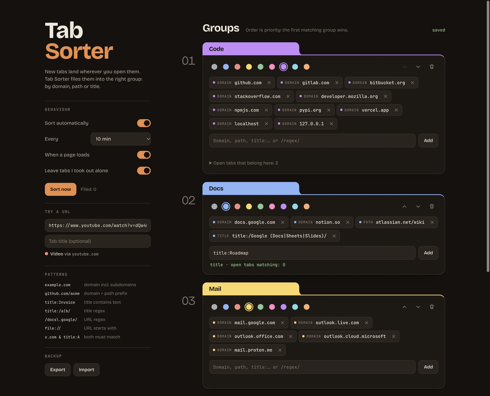
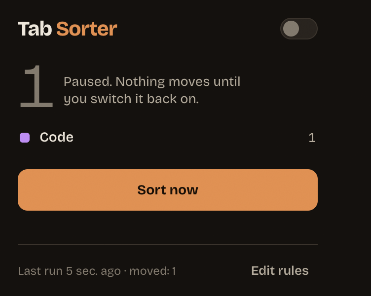

# Tab Sorter

A Chromium extension that files your ungrouped tabs into **tab groups by your
own rules**: domain, path, title or regex. Open a new tab anywhere; it moves
into the right group a moment later.



## Features

- Groups with name, color and a list of patterns, ordered by priority
- Live feedback while typing a pattern: what kind it is and how many open tabs it catches
- "Try a URL" box: shows which group and which pattern would win
- Sorts every N minutes, shortly after a page loads, on demand (popup, `⌥⇧S`/`Alt+Shift+S`, terminal)
- Never touches pinned tabs, tabs you already put in a group, incognito windows,
  or tabs you pulled out of a group by hand (until they change site)
- Reuses existing groups with the same name, creates missing ones per window
- JSON import/export, two starter presets, undo
- Light and dark theme, English and German UI
- No network access, no tracking: the extension needs only `tabs`, `tabGroups`, `alarms` and `storage`

## Patterns

| Pattern | Matches |
|---|---|
| `example.com` | domain incl. subdomains (`docs.example.com`) |
| `github.com/acme` | domain + path prefix (case-insensitive) |
| `localhost:5173` | host with port |
| `title:Invoice` | tab title contains text |
| `title:/exam\|quiz/` | tab title regex (case-insensitive) |
| `/docs\.google\.com\/spreadsheets/` or `url:/…/` | URL regex |
| `file://` | URL starts with (any `scheme://`) |
| `mail.google.com & title:Work` | all parts joined by ` & ` must match |

Groups are checked top to bottom; the first group with a matching pattern wins.
Regexes with nested quantifiers like `(a+)+` are rejected because they can
freeze the browser.



## Browser support

The extension uses Manifest V3 and the `chrome.tabGroups` API (Chromium 116+).

| Browser | Status |
|---|---|
| Google Chrome | tested (156) |
| Brave | tested (1.98) |
| Microsoft Edge | should work (has `chrome.tabGroups`), untested |
| Comet, other Chromium browsers with Chrome-style tab groups | should work, untested |
| Vivaldi, Opera, Arc | untested; they use their own tab stacking, so the tab groups API may be missing |
| Firefox, Safari | no (no tab groups extension API) |

## Install

Not in the Chrome Web Store (yet). Load it unpacked:

1. Download or clone this repository.
2. Open the extensions page: `chrome://extensions`, `brave://extensions`, `edge://extensions` …
3. Enable **Developer mode**.
4. **Load unpacked** → select the `extension/` folder.
5. The options page opens: start from a preset or create your first group.

To update, pull the repository and press the reload icon on the extension card.

### Terminal command (macOS, optional)

`bin/sort-tabs` sorts immediately in the first running supported browser
(Brave, Chrome, Edge, Chromium, Vivaldi, Comet), or the one in `TAB_SORTER_BROWSER`:

```sh
ln -s "$PWD/bin/sort-tabs" ~/.local/bin/sort-tabs
sort-tabs
TAB_SORTER_BROWSER="Google Chrome" sort-tabs
```

It works because the extension ID is fixed by the `key` in `manifest.json`
(`caijclkncckacdfoedpobdbopbaeomda`) for unpacked installs.

## Backup format

```json
{
  "groups": [
    { "title": "Code", "color": "purple", "patterns": ["github.com", "localhost"] }
  ],
  "settings": { "intervalMinutes": 5, "sortOnNavigate": true, "respectManualUngroup": true, "paused": false }
}
```

Colors: `grey blue red yellow green pink purple cyan orange`. Imports are
validated; invalid patterns are reported and skipped.

## Development

```
extension/
  background.js     service worker: triggers, alarm, message handling
  lib/patterns.js   pattern language (pure, unit tested)
  lib/config.js     config schema, validation, classification
  lib/sorter.js     grouping logic against the chrome.* API
  lib/store.js      chrome.storage wrapper
  lib/presets.js    starter rule sets
  ui/               options page, popup, shared styles, i18n helper
  _locales/         en, de (generated by tools/build-locales.py)
```

Requires Node 22+ (tests only; the extension has no build step and no dependencies).

```sh
npm test                    # unit tests: patterns, config, sorter, i18n keys
npm run test:e2e            # real browser, throwaway profile, drives the UI via CDP, writes docs/*.png
BROWSER_BIN="/Applications/Google Chrome.app/Contents/MacOS/Google Chrome" npm run test:e2e
python3 tools/build-locales.py   # after editing UI strings
python3 tools/build-icons.py     # re-render the icon (needs Pillow)
```

Google Chrome 137+ ignores `--load-extension`; the e2e test then loads the
extension through the DevTools protocol (`Extensions.loadUnpacked`).

Design notes: [Design.md](Design.md).

## License

[MIT](LICENSE). Bundled fonts (Bricolage Grotesque, JetBrains Mono) are under
the SIL Open Font License 1.1, see `extension/fonts/LICENSE.txt`.
